<!-- TOP BADGES -->

  
  
   
  
  

<!-- Animated Gradient Banner -->

  

<!-- HERO CARD -->

  

<!-- Social Badges -->

  
  
  
  <!-- Add more here if you have them, for example:
  
  
  -->

  

  

<!-- ABOUT ME -->
## 🚀 About Me

  

- 🌍 **European dev** crafting global solutions
- 🎯 **Currently building:** Flask + Next.js App
- 💬 **Coding languages I vibe with:**
`Python` `Go` `TypeScript` `JavaScript`
- 🔎 **Exploring:** Backend scalability, and UI/UX magic
- 🤝 **Open to:** side-projects, collabs, freelance missions
- 📬 **Contact:** bojanavasilevska@gmail.com
- ✨ *"Turn coffee into scalable code."*

 

  

<!-- FEATURED PROJECTS -->
## 🌟 Featured Projects

  

<table>
  <tr>
    <td width="50%" valign="top">
      <h3>📊 Flask E-commerce Analytics</h3>
      
A Flask app that analyzes e-commerce orders and payments and turns the raw data into clear, useful insights.

      

        
        
        
      

      
    </td>
    <td width="50%" valign="top">
      <h3>🥗 Calorie Tracker</h3>
      
An app for tracking and managing daily calorie intake, with a simple and friendly interface.

      

        
        
        
      

      
    </td>
  </tr>
  <tr>
    <td width="50%" valign="top">
      <h3>🎨 My Favorite Colors</h3>
      
A small web app where users can save and browse their favorite colors.

      

        
        
      

      
    </td>
    <td width="50%" valign="top">
      <h3>🍕 Yammi Pizza App</h3>
      
A mobile app for ordering pizzas from a wide selection.

      

        
        
      

      
    </td>
  </tr>
</table>

<!-- TECH STACK -->
## 🛠️ Tech Stack

  

  

**Languages**

  
  
  
  

**Frontend**

  
  
  
  
  

**Backend & Data**

  
  

**Tools & Design**

  
  
  

<!-- GITHUB STATS -->
## 📈 GitHub Stats

  

  

  
  

  
  

<!-- HOW I BUILD -->
## 💻 How I Build

  

<!-- CURRENTLY EXPLORING -->
## 🔍 Currently Exploring

  

- ⚡ Backend scalability with **Go**
- 🔗 Connecting **Flask APIs** with **Next.js** frontends
- 🗄️ Better **PostgreSQL** design and performance
- 🎨 UI/UX magic with **Figma** and **Tailwind CSS**
- 🐳 Deploying full-stack apps to the cloud

<!-- FUN FACTS -->
## ✨ Fun Facts

  

- ☕ Coffee makes my code 10x better
- 🧘‍♀️ I balance bugs with yoga poses
- 🌍 Fluent in tech & travel

<!-- WHAT I'M LOOKING FOR -->
## 💼 What I'm Looking For

  

I'm open to **Full Stack**, **Backend** and **Frontend Developer** opportunities, as well as **freelance projects**, **side-projects** and **collaborations** where I can build real products and keep learning.

**If you'd like to collaborate, discuss an opportunity, or just connect, feel free to reach out!**

  

<!-- LET'S CONNECT -->
## 📫 Let's Connect!

  

  
  

### Thanks for visiting my profile! 💜

**If you like my work, consider giving a ⭐ to the repositories you find useful.**

Made with ❤️ and ☕

  

  

