  
  
  

  

  
  
  

  

---

  

---

## 🛠️ Tech Stack

  
    
  

---

## 📈 GitHub Stats

  
  

  
  

  

---

## 💻 How I Build

  

---

## 💼 What I'm Looking For

I'm looking for **Full Stack**, **Backend** and **Frontend Developer** roles, plus **freelance** work, where I can build real products and keep growing.

  

  

  

